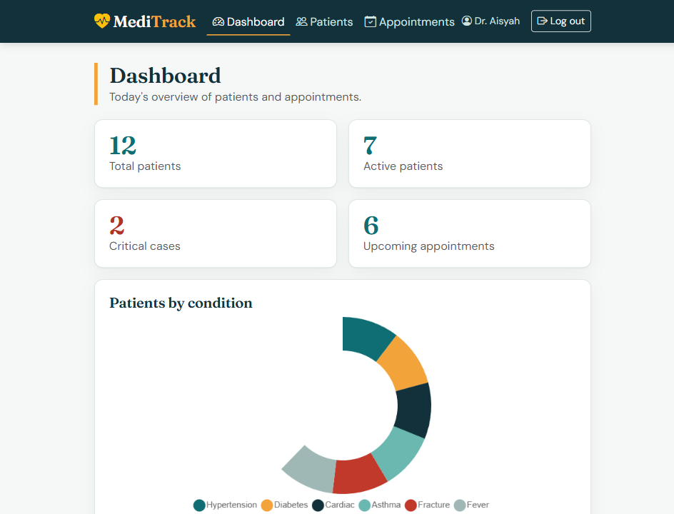
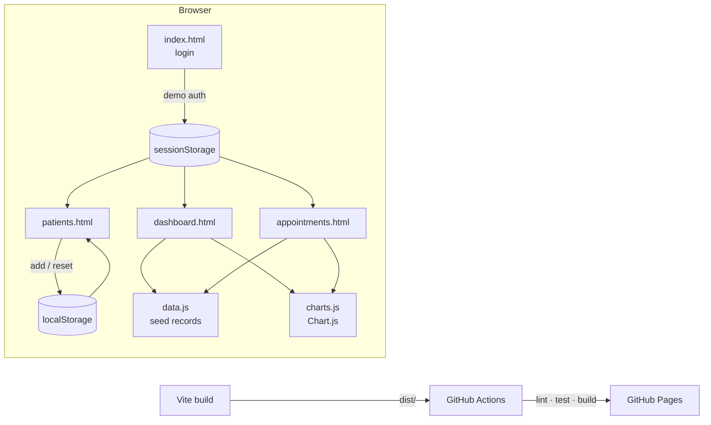

# MediTrack

**A fast, accessible clinic dashboard for patients and appointments — no backend, no build-time secrets, works offline once loaded.**

[](https://github.com/alishawhda/MediTrack/actions/workflows/ci.yml)
[](https://github.com/alishawhda/MediTrack/actions/workflows/deploy.yml)
[](LICENSE)
[](CHANGELOG.md)



## Why it exists

MediTrack is the IMS566 individual project: a clinic patient-management
prototype. It was originally four hand-written HTML pages with global scripts.
This repository turns it into a maintainable app: ES modules, a real test
suite, linting, CI, accessibility work, and a one-command dev server — while
staying a **static site** that can be hosted on GitHub Pages for free.

## Quickstart

```bash
git clone https://github.com/alishawhda/MediTrack.git
cd MediTrack
npm install && npm start
```

Open <http://localhost:5173>. Sign in with:

| Username | Password       |
| -------- | -------------- |
| `admin`  | `meditrack123` |

> Demo credentials only. Authentication runs entirely in the browser; there is
> no server and no real patient data. See [SECURITY.md](SECURITY.md).

## Features

- **Demo login** with inline errors, show/hide password, and a 5-attempt
  lockout with a countdown message.
- **Dashboard** with live summary cards, two Chart.js charts, and the five
  soonest appointments.
- **Patients** with instant search, status filter, add-patient dialog,
  field-level validation, and browser-persisted records.
- **Appointments** with status filtering, human-readable dates, and a
  department chart.
- **Accessible by default**: skip link, semantic headings, labelled controls,
  visible focus rings, `aria-live` updates, keyboard-friendly modal, and
  reduced-motion support.
- **Resilient**: corrupt or missing `localStorage` falls back to demo data
  instead of breaking the page.
- **Fast**: static output, ~59 kB gzipped charts, no runtime CDN dependency for
  Bootstrap or Chart.js.

## Architecture



| Layer              | Responsibility                                           |
| ------------------ | -------------------------------------------------------- |
| `src/js/data.js`   | Seed data, storage, filtering, validation, pure helpers  |
| `src/js/auth.js`   | Demo credential check, session helpers, lockout throttle |
| `src/js/ui.js`     | Navbar/footer, status pills, dates, toasts               |
| `src/js/shell.js`  | Session guard + shared page chrome                       |
| `src/js/pages/*`   | One controller per page; each exports an `init…Page()`   |
| `src/js/charts.js` | Chart.js registration and accessible chart factories     |

Every page controller is a plain function with injectable `doc`, `storage` and
`navigate`, which is why the integration tests can drive them in jsdom without
a browser.

## Project structure

```
.
├── index.html               # Login
├── dashboard.html
├── patients.html
├── appointments.html
├── src/
│   ├── js/
│   │   ├── data.js          # domain + persistence (pure)
│   │   ├── auth.js          # demo auth adapter
│   │   ├── ui.js            # shared rendering
│   │   ├── shell.js         # guard + chrome
│   │   ├── charts.js
│   │   └── pages/           # login, dashboard, patients, appointments
│   └── styles/main.css      # tokens + components
├── tests/                   # Vitest unit + jsdom integration tests
├── docs/
│   ├── adr/                 # architecture decision records
│   └── screenshots/
└── .github/                 # CI, deploy, templates, Dependabot
```

## Commands

| Command                     | What it does                            |
| --------------------------- | --------------------------------------- |
| `npm start` / `npm run dev` | Vite dev server on port 5173            |
| `npm test`                  | Run the 57-test Vitest suite            |
| `npm run test:watch`        | Re-run tests on change                  |
| `npm run lint`              | ESLint (flat config)                    |
| `npm run format`            | Prettier write                          |
| `npm run format:check`      | Prettier check (used by CI)             |
| `npm run build`             | Production build into `dist/`           |
| `npm run preview`           | Serve the production build on port 4173 |

Requires Node **20.19+** (22 recommended).

## Deploying

Pushes to `main` build and deploy automatically through
`.github/workflows/deploy.yml` using GitHub Pages. One-time setup in the repo:

1. **Settings → Pages → Build and deployment → Source: GitHub Actions.**
2. Push to `main` and watch the **Deploy** workflow.

The build uses `base: './'`, so it also works from a project subpath
(`/MediTrack/`) without configuration.

## Quality gates

CI runs on every push and pull request:

- `npm ci` with a committed lockfile
- ESLint
- Prettier check
- Vitest (unit + jsdom integration)
- `vite build`

`npm audit` currently reports **0 vulnerabilities**; Dependabot keeps it that
way.

## Roadmap

- [ ] Replace demo auth with a real API and server-side sessions
- [ ] Add appointment create/edit and patient detail pages
- [ ] Add Playwright end-to-end tests against the built site
- [ ] Add CSV import/export for patient records
- [ ] Add a dark theme and print-friendly patient summaries

## Known limitations

- **No backend.** Records live in `localStorage` per browser; clearing site
  data resets them.
- **Demo authentication only.** Credentials are client-side by design. Do not
  use this for real patient data.
- **Seed data is fictional** and uses Malaysian clinic conventions (not real
  people).
- Charts require JavaScript; the tables remain readable without it.

## Contributing

Issues and pull requests are welcome. Read [CONTRIBUTING.md](CONTRIBUTING.md)
and [CODE_OF_CONDUCT.md](CODE_OF_CONDUCT.md) first.

## License

[MIT](LICENSE) © 2026 alishawhda
